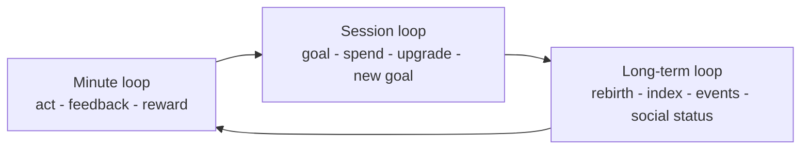
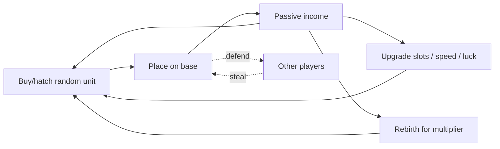
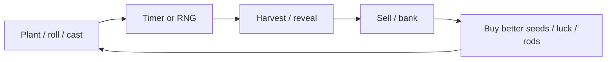

# Core Gameplay Loops

A core loop is the repeating cycle everything else hangs on. Roblox's design docs define it as three parts: the minute-to-minute interaction, the most repeated actions (usually the defining mechanic), and the progression engine that keeps the loop from feeling shallow ([Core loops](https://create.roblox.com/docs/en-us/production/game-design/core-loops.md)). This note layers that into **minute / session / long-term loops**, shows the loop of each top-game genre, and covers compulsion-loop mechanics and their ethical limits. Apply it with [[Retention and Progression Systems]] and [[Genre Playbooks]].

## Three nested loops



| Loop | Timescale | Question it answers | Typical tools |
|---|---|---|---|
| Minute | 5–60 s | "Is this fun right now?" | Juicy feedback, numbers going up, sound |
| Session | 5–30 min | "What am I working toward today?" | Upgrades, quests, timers, shop restocks |
| Long-term | days–months | "Why come back tomorrow?" | Rebirth, indexes, events, trading, leaderboards |

Roblox's analytics docs map these to retention stages: core loop and first-time experience drive D1, the progression system drives D7, and the "ending system" (regular content plus social features) drives D30 ([Retention analytics](https://create.roblox.com/docs/en-us/production/analytics/retention.md)).

## Anatomy of a strong minute loop

1. **Verb** — a single action the player repeats (plant, hatch, steal, throw, swing, fish).
2. **Feedback** — immediate VFX/SFX/number popups (see the audio and VFX folders).
3. **Reward** — currency, rarity roll, progress bar.
4. **Decision** — what to spend it on (this creates strategy).
5. **Re-entry** — the next action is visible within a second.

If a player must read to continue, the loop leaks. Roblox warns that lengthy tutorials bore users who hop between games ([Design for Roblox](https://create.roblox.com/docs/en-us/production/game-design/design-for-roblox.md)).

## Loop of each top-game genre

### Steal/collect tycoon ([[Steal a Brainrot]], [[Steal An Egg]], [[Break and Steal an Egg]], [[Throw Food For Animals]])



Steal a Brainrot: buy or steal characters from a central conveyor, earn income over time, defend with shields/traps, rebirth for permanent multipliers ([Wikipedia](https://en.wikipedia.org/wiki/Steal_a_Brainrot)). Steal An Egg: collect eggs, hatch pets with rarities/sizes/mutations, upgrade base and treadmills, and steal eggs from others ([Otakukart](https://otakukart.com/robloxs-steal-an-egg-reaches-6-billion-visits-and-14-2-million-peak-concurrent-players/)). Details in [[Steal and Collect Tycoon Formula]].

### Garden / idle incremental ([[Grow a Garden]], [[Pet Simulator 99]], [[Sols RNG]], [[Fish It]], [[Fisch]])



Grow a Garden: plant seeds, harvest, sell, and buy rarer seeds; a shared shop restocks every five minutes ([Fortune](https://fortune.com/2025/07/30/roblox-video-game-grow-a-garden-viral-summer-hit/)). Sols RNG-style games replace the verb with a roll and attach auras/rarity.

### Pet collecting and care ([[Adopt Me]], [[Pet Simulator 99]])

Care for pets, earn bucks, decorate, combine pets into Neon/Mega Neon, trade ([Naavik](https://naavik.co/deep-dives/roblox-blox-fruits-brookhaven-adopt-me/)).

### Action RPG / grind ([[Blox Fruits]])

```text
Quest -> fight NPCs -> XP + money -> level up -> new island -> stronger fruit/sword -> boss/raid -> repeat
```
Blox Fruits relies on content volume, deep systems and frequent updates, with little tutorial; Naavik notes a September 2022 update doubled concurrents overnight ([Naavik](https://naavik.co/deep-dives/roblox-blox-fruits-brookhaven-adopt-me/)).

### Social deduction / 1-vs-all ([[Murder Mystery 2]], [[Violence District]], [[Forsaken]])

```text
Lobby -> assign role -> round (10 min) -> win/lose -> coins/cosmetics -> lobby
```
Short rounds make each match a complete story; progression is cosmetic or collectible.

### Co-op survival / horror ([[99 Nights in the Forest]], [[Doors]], [[Dandys World]], [[Evade]])

```text
Prep (gather) -> threat arrives (night/door/entity) -> survive -> reward currency -> unlock gear -> go deeper
```
Doors sells consumables via a pre-run elevator shop ([Contextual purchases](https://create.roblox.com/docs/en-us/production/game-design/contextual-purchases.md)).

### Competitive / battlegrounds ([[Rivals]], [[The Strongest Battlegrounds]], [[Jujutsu Shenanigans]], [[Blade Ball]])

```text
Queue -> match -> win/lose -> rank/skin/crate -> queue
```
Skill expression is the minute loop; cosmetics and ranks are the long loop.

### Dress-up / roleplay ([[Dress To Impress]], [[Brookhaven RP]])

Dress To Impress: theme, 360 seconds to build an outfit, catwalk, star ratings, podium, rank-ups ([Wikipedia](https://en.wikipedia.org/wiki/Dress_to_Impress_(video_game))). Brookhaven has no fixed goals; self-expression and property ownership are the loop ([Naavik](https://naavik.co/deep-dives/roblox-blox-fruits-brookhaven-adopt-me/)).

### Tower defense ([[Tower Defense Simulator]], [[Anime Adventures]])

```text
Wave -> place/upgrade towers -> earn cash -> survive -> reward -> unlock towers -> harder mode
```

### Runner/obby ([[Dont Splash]])

Short attempts with instant restart, escalating difficulty, cosmetic or speed rewards.

## Compulsion-loop mechanics (and how to use them responsibly)

| Mechanic | What it does | Example | Caution |
|---|---|---|---|
| Variable-ratio rewards | Unpredictable rarity makes each roll exciting | Egg hatches, seed rolls | Must disclose odds if purchasable with Robux ([Paid random items](https://create.roblox.com/docs/production/monetization/paid-random-items)) |
| Near-miss display | Show the chance of the rare thing | Reveal animation passing a rare tier | Avoid fake odds |
| Timers / appointments | Reasons to return | 5-minute shop restock | Don't punish absence too hard |
| Collection completion | Indexes/books | Pet index | Cap the grind |
| Sunk cost | Rebirth multipliers, streaks | Rebirths | Don't make progress loss feel punishing |
| Social comparison | Leaderboards, status items | Rare pet flex | Mind younger audience |

Roblox policy expects clear disclosure of odds and has regional restrictions on paid random items; see [[Monetization Patterns]]. The Roblox DevForum "Boost your discovery" post asks creators to make the core loop fun, clear and rewarding before layering monetization ([DevForum](https://devforum.roblox.com/t/boost-your-discovery-by-building-games-people-want-to-play/4779042)).

## Prototype a loop quickly

1. Write the loop as one sentence: "Players [verb] to [earn], then [spend] to [become more able to verb]."
2. Prototype the minute loop with gray boxes; Roblox lists prototyping as its own step ([Game design docs](https://create.roblox.com/docs/production/game-design.md)).
3. Test whether a stranger does the second iteration without prompting.
4. Add the session loop (first upgrade within 60 seconds; see [[Onboarding and First Session]]).
5. Add long-term hooks after D1 is acceptable.

## Loop-health checklist

- [ ] First reward within 10 seconds of first input.
- [ ] First upgrade or decision within 60 seconds.
- [ ] Each session has a visible "next goal" at all times.
- [ ] Progress is never fully blocked behind payment.
- [ ] Rebirth/prestige gives a meaningfully faster second run.
- [ ] Social interaction occurs without needing to talk.
- [ ] Mobile controls support the minute loop with one thumb.

## References

- [Core loops (Creator Docs)](https://create.roblox.com/docs/en-us/production/game-design/core-loops.md) — official docs · three-part core loop definition
- [Game design overview (Creator Docs)](https://create.roblox.com/docs/production/game-design.md) — official docs · design section index
- [Retention analytics (Creator Docs)](https://create.roblox.com/docs/en-us/production/analytics/retention.md) — official docs · D1/D7/D30 mapping
- [Design for Roblox (Creator Docs)](https://create.roblox.com/docs/en-us/production/game-design/design-for-roblox.md) — official docs · short tutorials, mobile-first
- [Contextual purchases (Creator Docs)](https://create.roblox.com/docs/en-us/production/game-design/contextual-purchases.md) — official docs · Doors pre-run shop
- [Paid random items (Creator Docs)](https://create.roblox.com/docs/production/monetization/paid-random-items) — official policy · odds disclosure
- [Boost your discovery (DevForum)](https://devforum.roblox.com/t/boost-your-discovery-by-building-games-people-want-to-play/4779042) — Roblox staff post · fun core loop first
- [Naavik: Roblox top games deep dive](https://naavik.co/deep-dives/roblox-blox-fruits-brookhaven-adopt-me/) — analysis · loops of Blox Fruits, Brookhaven, Adopt Me
- [Steal a Brainrot (Wikipedia)](https://en.wikipedia.org/wiki/Steal_a_Brainrot) — encyclopedia · steal loop
- [Steal an Egg (Otakukart)](https://otakukart.com/robloxs-steal-an-egg-reaches-6-billion-visits-and-14-2-million-peak-concurrent-players/) — press · egg loop
- [Grow a Garden (Fortune)](https://fortune.com/2025/07/30/roblox-video-game-grow-a-garden-viral-summer-hit/) — press · garden loop
- [Dress to Impress (Wikipedia)](https://en.wikipedia.org/wiki/Dress_to_Impress_(video_game)) — encyclopedia · round structure
- [List of Roblox games (Wikipedia)](https://en.wikipedia.org/wiki/List_of_Roblox_games) — encyclopedia · loop descriptions by game
- [Top Roblox games September 2026 (StudioKrew)](https://studiokrew.com/blog/top-roblox-games-september-2026/) — blog · speed-as-progression trend (unverified)

Links: [[Game Design MOC]] · [[00 Home]]
