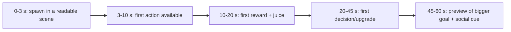

# Onboarding and First Session

Roblox treats the first-time user experience (FTUE) as the biggest single lever on Day-1 retention, and its recommendation system explicitly penalizes games with a high *first-play bounce rate* (under 60 seconds and 61–180 seconds) ([Discovery](https://create.roblox.com/docs/discovery)). This note gives a minute-by-minute template, Roblox's three onboarding techniques, metrics to instrument, and what chart games do. See also [[Core Gameplay Loops]], [[Retention and Progression Systems]], [[What Every Roblox Game Needs]].

## What Roblox says

- Players decide "within minutes"; the FTUE should teach essentials, reach fun quickly and leave players wanting more. Test tutorial steps with Experiments (e.g., shorter dialogue vs guided arrow), keep early XP thresholds low, give goals (skill trees, season passes, quests, collections), and **end onboarding on a designed moment of joy** ([Onboarding](https://create.roblox.com/docs/en-us/production/game-design/onboarding.md)).
- Get to fun within about five minutes ([Retention](https://create.roblox.com/docs/en-us/production/analytics/retention.md), [Engagement](https://create.roblox.com/docs/production/analytics/engagement)). Roblox's platform guidance says long tutorials bore users who hop between games ([Design for Roblox](https://create.roblox.com/docs/en-us/production/game-design/design-for-roblox.md)).
- Three techniques ([Onboarding techniques](https://create.roblox.com/docs/en-us/production/game-design/onboarding-techniques.md)):
  1. **Visual elements** — signs in line of sight, highlights (outline + arrow, dim the rest), persistent hints (e.g., footprints), and feedback to every action (VFX, damage numbers, screen pulse).
  2. **Contextual (just-in-time) tutorials** — triggered when the player first needs the mechanic (e.g., holding two identical Squishmallows triggers the combine tutorial).
  3. **Timed hints** — show help only to struggling players after most have finished (a hint at 11 seconds when most players act within 10), once, and only if needed; A/B test 5 vs 10 second delays.
- Dashboards: the player funnel tracks completion per FTUE step; the new-user first-session retention chart shows how many are still playing X minutes after joining ([Onboarding](https://create.roblox.com/docs/en-us/production/game-design/onboarding.md), [Engagement](https://create.roblox.com/docs/production/analytics/engagement)).

## First 60 seconds template

| Time | Goal | Tactics |
|---|---|---|
| 0–3 s | Orient | No modal wall; camera frames the first object; mobile UI uncluttered |
| 3–10 s | First verb | One glowing prompt / arrow; no reading needed |
| 10–20 s | First reward | Currency pop, sound, number-up (see audio/VFX folders) |
| 20–45 s | First choice | Cheap first purchase affordable instantly (tune starter cash) |
| 45–60 s | Hook | Show next tier silhouette; first rare tease; friends/shop teaser |

Starter economy: test several starting currency amounts with Experiments and apply the winner globally with Configs (Roblox's recommended workflow) ([Onboarding](https://create.roblox.com/docs/en-us/production/game-design/onboarding.md)).

## First session (0–15 minutes) design

1. **Minute 1:** first loop completes once, ending on a celebration.
2. **Minute 2–5:** unlock a second system through contextual tutorial (e.g., upgrades).
3. **Minute 5–10:** first rarity moment or milestone (rare hatch, first rebirth preview).
4. **Minute 10–15:** social touchpoint (friend invite, trade teaser, leaderboard).
5. **Exit:** make logging off feel like pausing: offline income preview, daily reward claim timer, notification opt-in (experience notifications support milestones and high scores) ([Discovery](https://create.roblox.com/docs/discovery)).

Platform datapoints: GameAnalytics percentile data shows retention and ARPPU climbing with average session length, so keep first sessions *long enough to matter*—games under ~3 minutes had median D1 around 4% while games at 19–24 minutes had about 11% ([GameAnalytics 2025](https://www.gameanalytics.com/reports/2025-roblox-report)).

## Chart-game patterns

| Game | Onboarding style |
|---|---|
| [[Steal a Brainrot]] / [[Steal An Egg]] | Starter item and cash, instant buy/place/earn; stealing is learned by seeing it |
| [[Grow a Garden]] | Starter seed and cash, plant-harvest-sell in seconds, shared shop alerts guide players ([Fortune](https://fortune.com/2025/07/30/roblox-video-game-grow-a-garden-viral-summer-hit/)) |
| [[Blox Fruits]] | Little or no FTUE; players learn from each other (Naavik criticism) ([Naavik](https://naavik.co/deep-dives/roblox-blox-fruits-brookhaven-adopt-me/)) |
| [[Doors]] | Simple verbs (move, open door, hide); fear teaches mechanics; pre-run shop |
| [[Dress To Impress]] | Theme appears first; 360-second timer drives immediate action ([Wikipedia](https://en.wikipedia.org/wiki/Dress_to_Impress_(video_game))) |
| [[Adopt Me]] | Gradual rollout of features to avoid overwhelming new players ([Naavik](https://naavik.co/deep-dives/roblox-blox-fruits-brookhaven-adopt-me/)) |
| [[Pet Simulator 99]] | First egg quickly; index and quests reveal depth (observation, unverified) |

## Metrics to instrument (FTUE)

- Funnel: spawned -> first input -> first reward -> first purchase -> tutorial complete -> second session.
- First-play bounce at <60 s and 61–180 s (Roblox ranking input).
- New-user first-session retention at 5/10/15 minutes.
- D1 retention and avg session time; D7 later ([Retention](https://create.roblox.com/docs/en-us/production/analytics/retention.md)).
- Crash and FPS rates by device (Roblox recommends testing across devices; most users are on mobile).
- Use custom events and third-party analytics if needed ([Third-party analytics](https://create.roblox.com/docs/production/analytics/third-party-analytics)).

## Mobile-first rules

- Thumb-reachable buttons, large hit targets, minimal text, consistent icons ([Design for Roblox](https://create.roblox.com/docs/en-us/production/game-design/design-for-roblox.md)).
- Consider UX docs on interfaces ([UI and UX design](https://create.roblox.com/docs/en-us/production/game-design/ui-ux-design.md)); UI breakdowns are in the UI folder.
- Defer heavy asset loading; show playable content before decorative areas.

## Common failures

| Failure | Fix |
|---|---|
| Wall of text | Replace with icons, arrows, contextual prompts |
| Unaffordable first upgrade | Raise starter cash; test with Experiments |
| Forced waiting | Give something to do during timers |
| Hidden controls | Show controls on screen for mobile and gamepad |
| Tutorial can't be skipped | Allow skip for returning players |
| Monetization popups on first minute | Delay offers until after the first success; starter packs after the first loop |
| Mismatch between thumbnail and game | Roblox downranks mismatched metadata ([Discovery](https://create.roblox.com/docs/discovery)) |

## Checklist

- [ ] First action within 5 seconds of spawn.
- [ ] First reward within 20 seconds.
- [ ] No tutorial longer than 60 seconds total.
- [ ] Contextual tutorials for secondary systems.
- [ ] Timed hint for stuck players (once).
- [ ] Onboarding ends with a celebratory moment and a visible next goal.
- [ ] Funnel tracked and A/B tests planned.

## References

- [Onboarding (Creator Docs)](https://create.roblox.com/docs/en-us/production/game-design/onboarding.md) — official docs · FTUE funnel and advice
- [Onboarding techniques (Creator Docs)](https://create.roblox.com/docs/en-us/production/game-design/onboarding-techniques.md) — official docs · visual, contextual, timed hints
- [Design for Roblox (Creator Docs)](https://create.roblox.com/docs/en-us/production/game-design/design-for-roblox.md) — official docs · short tutorials, mobile-first
- [UI and UX design (Creator Docs)](https://create.roblox.com/docs/en-us/production/game-design/ui-ux-design.md) — official docs · UI design (listed in docs index)
- [Retention analytics (Creator Docs)](https://create.roblox.com/docs/en-us/production/analytics/retention.md) — official docs · D1 advice
- [Engagement analytics (Creator Docs)](https://create.roblox.com/docs/production/analytics/engagement) — official docs · first-session retention
- [Discovery (Creator Docs)](https://create.roblox.com/docs/discovery) — official docs · first play bounce rate
- [Third-party analytics (Creator Docs)](https://create.roblox.com/docs/production/analytics/third-party-analytics) — official docs · external tools
- [GameAnalytics 2025 Roblox report](https://www.gameanalytics.com/reports/2025-roblox-report) — industry report · session-length percentiles
- [Naavik: Roblox top games](https://naavik.co/deep-dives/roblox-blox-fruits-brookhaven-adopt-me/) — analysis · FTUE of Blox Fruits, Adopt Me
- [Grow a Garden (Fortune)](https://fortune.com/2025/07/30/roblox-video-game-grow-a-garden-viral-summer-hit/) — press · starter flow
- [Dress to Impress (Wikipedia)](https://en.wikipedia.org/wiki/Dress_to_Impress_(video_game)) — encyclopedia · round timer
- [First-week retention optimization (Rolearn)](https://rolearn.dev/guidance/first-week-retention-optimization) — blog · early retention advice (unverified)
- [Onboarding glossary (Creation.dev)](https://www.creation.dev/glossary/onboarding) — glossary · guided first experience (secondary)
- [Why games bleed players between sessions 2 and 5 (RoWatcher)](https://rowatcher.com/news/why-your-roblox-game-bleeds-players-between-sessions-2-and-5) — blog · early-session drop (opinion)

Links: [[Game Design MOC]] · [[00 Home]]
