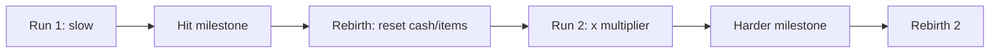

# Retention and Progression Systems

Retention decides whether a spike becomes a franchise, and it is also what Roblox's recommendation system rewards. This note covers retention benchmarks (D1/D7/D30), the systems that move each metric — daily rewards, streaks, quests, rebirth/prestige, battle passes, collections, events, FOMO and offline earnings — and how the chart games use them. Companion notes: [[Core Gameplay Loops]], [[Live Ops and Update Cadence]], [[Onboarding and First Session]], [[Roblox Discovery Algorithm and Metrics]].

## Benchmarks (use with caution)

Roblox's official docs give **no target percentages**; they say to judge by trends in your own cohorts and compare with similar-experience benchmarks in Creator Analytics ([Retention](https://create.roblox.com/docs/en-us/production/analytics/retention.md)). Third-party data:

- GameAnalytics reported D1 averaging ~12–15% on Roblox, falling to ~1% by D90, and that short sessions (0–6 min) struggle while hits emerge around 19+ minutes ([Naavik search summary of GameAnalytics](https://www.gameanalytics.com/reports/2025-roblox-report)).
- GameAnalytics 2025 percentile tables by average session length: for 19–24 minute games the median D1 is about 11.5% (P90 about 18%), D7 median about 1.6%, D30 median about 0.46%; for 25+ minute games the median D1 is about 10.8%, D7 about 1.8%, D30 about 0.5%. For 0–3 minute games the median D1 is about 4.3% and D30 about 0.13% ([GameAnalytics 2025 Roblox report](https://www.gameanalytics.com/reports/2025-roblox-report)).
- Takeaway: **session length is the strongest lever**; each bracket upward lifts D1, D7 and ARPPU.

| Metric | Rough "good" for a new Roblox game (design target, not official) |
|---|---|
| D1 | 15–25% |
| D7 | 3–6% |
| D30 | 1–2% |
| Avg session | 15–25+ min |
| Sessions/day (retained players) | 2+ |

(Targets derived from the percentile tables above; treat as planning ranges.)

## Which system moves which metric

Roblox's retention guide maps stages ([Retention](https://create.roblox.com/docs/en-us/production/analytics/retention.md)):

| Metric | Driver | Systems |
|---|---|---|
| D1 | Core loop + first-time experience + performance | Tutorial, first reward, stability, mobile support |
| D7 | Progression system | Levels, quests, rebirth, unlock tiers, goals at multiple time scales |
| D30 | "Ending system" | Regular content (small updates every 2–4 weeks; large every 2–3 months), social features: trading, parties, guilds, PvP, tournaments, leaderboards |

Also from the docs: measure progression with milestone items and adjust if players move too fast (run out of content) or too slow (bored).

## Daily rewards and streaks

- Roblox ships an **Engagement Rewards** feature package supporting *Time* rewards (per session) and *Daily* rewards that unlock after consecutive-day streaks, with options like aligning streak reset time ([Engagement Rewards](https://create.roblox.com/docs/resources/feature-packages/engagement-rewards)).
- Design rules:
  - Escalate: small day 1–3, notable day 7, rare item at day 14/30.
  - Forgive: allow one missed day or "streak freeze" (sold or earned).
  - Pair with a visible calendar and badge on the lobby button.
  - Make the reward useful *in the loop*, not just decorative.
- Evidence is mixed: third-party analysts argue login bonuses are extrinsic and backfire after ~2 weeks, and recommend social play as the stronger driver ([RoWatcher: reward schedules](https://rowatcher.com/news/reward-schedules-in-roblox-why-daily-login-bonuses-backfire), [RoWatcher: after Day 14](https://rowatcher.com/news/why-roblox-reward-schedules-break-after-day-14), opinion). A DevForum poster still lists daily login rewards as a retention tactic ([DevForum](https://devforum.roblox.com/t/make-your-game-populargood/3024181)).
- Roblox itself pays creators **Creator Rewards** (5 Robux when an Active Spender plays 10+ minutes in one of their first three experiences that day) — this makes daily return more valuable to you as a creator ([Creator Rewards](https://create.roblox.com/docs/creator-rewards)).

## Quests and tasks

Roblox's quest-design guide: dailies are short tasks with modest soft-currency rewards completable in one session; mix short (single session), mid (days to weeks) and long (months) goals; use quests as tutorials and to surface features; scale reward to difficulty ([Quest design](https://create.roblox.com/docs/en-us/production/game-design/introduction-to-quest-design.md)). Examples in the doc: "collect 100 apples", "slay 5 monsters", "visit 10 players' homes".

## Rebirth / prestige

- Used in [[Steal a Brainrot]] (rebirth for better stats and currency) ([Wikipedia](https://en.wikipedia.org/wiki/Steal_a_Brainrot)) and most tycoon/simulator titles ([[Pet Simulator 99]], [[Grow a Garden]]-style games).
- Rules: each rebirth should be roughly 20–40% faster than the last first loop, cost increases superlinearly, rebirth count is a public status symbol, and permanent shop perks (kept after rebirth) make resetting feel like gain.
- Avoid the "reset cliff": give a first-minute burst of progress right after rebirth.

## Battle / season passes

Roblox's season-pass guide: about one month per season with at least one week of rest; start with ~10 tiers; daily-unlocking missions across several categories; free + premium tracks; final reward an exclusive asset that is retired; auto-grant unclaimed rewards at season end; grant premium rewards retroactively if a free player upgrades mid-season ([Season pass design](https://create.roblox.com/docs/en-us/production/game-design/season-pass-design.md)). Missions must not require spending hard currency. Pricing is in [[Monetization Patterns]]; subscriptions can host the premium track ([Subscription design](https://create.roblox.com/docs/en-us/production/game-design/subscription-design.md)).

## Collections, indexes and trading

- [[Adopt Me]] uses Neon/Mega Neon combining and a trade economy to build a long-term collection goal ([Naavik](https://naavik.co/deep-dives/roblox-blox-fruits-brookhaven-adopt-me/)).
- [[Pet Simulator 99]] and [[Sols RNG]] present an index of everything discoverable, with completion rewards.
- [[Grow a Garden]] rewards completionists chasing rare seeds/animals ([Fortune](https://fortune.com/2025/07/30/roblox-video-game-grow-a-garden-viral-summer-hit/)).
- Make the index visible from minute one with greyed silhouettes. See [[Social Features and Multiplayer Hooks]] for trading rules.

## Limited-time events and FOMO

- Roblox recommends mixing steady **content cadence** (new pets, vehicles, quests every 2 weeks to a month) with major updates months apart; limited-time events create prestige for those who earn them ([LiveOps essentials](https://create.roblox.com/docs/en-us/production/game-design/liveops-essentials.md), [Content updates](https://create.roblox.com/docs/en-us/production/game-design/content-updates.md)).
- Use a separate **event currency** so event spending does not wreck the main economy ([Balance virtual economies](https://create.roblox.com/docs/en-us/production/game-design/balance-virtual-economies.md)).
- FOMO ethics: always show the end date, never delete earned items, offer a catch-up (double XP last week, per the season guide), and avoid stacking daily guilt mechanics on younger audiences.
- [[Dress To Impress]] and [[Murder Mystery 2]] show seasonality: MM2 fell about 64% month over month in a tracker's September 2026 snapshot after its summer event ended ([StudioKrew](https://studiokrew.com/blog/top-roblox-games-september-2026/), unverified).

## Offline earnings

- Passive income is the strongest "come back" hook for tycoons: the number grew while you were away. Cap it (hours), tie extension to passes/subscriptions, and show a clear "welcome back" summary.
- Use Roblox notifications: experience notifications can pull players back with milestones, high scores and friend activity ([Discovery surfaces](https://create.roblox.com/docs/discovery)).

## Retention troubleshooting

| Symptom | Likely cause | Fix |
|---|---|---|
| D1 low | Confusing first minutes, crashes, long tutorial | Shorten FTUE, test devices, add a satisfying first loop ([Retention](https://create.roblox.com/docs/en-us/production/analytics/retention.md)) |
| D1 fine, D7 low | Progression too fast/slow, nothing to chase | Add mid-term goals, quests, indexes |
| D7 fine, D30 low | No content cadence or social endgame | Updates every 2–4 weeks, trading, parties, events |
| Drop after big influx | Normal dilution | Wait; compare cohorts ([Retention](https://create.roblox.com/docs/en-us/production/analytics/retention.md)) |
| New users leave after update | Onboarding or stability regression | Review recent changes and error reports ([Engagement](https://create.roblox.com/docs/production/analytics/engagement)) |

Use Experiments to A/B test changes and Configs to retune live ([Analytics essentials](https://create.roblox.com/docs/production/game-design/analytics-essentials)).

## Checklist

- [ ] D1 target defined; funnel instrumented per tutorial step.
- [ ] Daily reward or streak with forgiveness.
- [ ] 3 time-scale goals visible (session / week / month).
- [ ] Rebirth or equivalent with permanent perk.
- [ ] Index/collection screen visible early.
- [ ] Update calendar for 8 weeks.
- [ ] Offline earnings capped and previewed.
- [ ] Season or event plan with separate currency.

## References

- [Retention analytics (Creator Docs)](https://create.roblox.com/docs/en-us/production/analytics/retention.md) — official docs · D1/D7/D30 guidance
- [Engagement analytics (Creator Docs)](https://create.roblox.com/docs/production/analytics/engagement) — official docs · session time
- [Analytics essentials (Creator Docs)](https://create.roblox.com/docs/production/game-design/analytics-essentials) — official docs · Experiments and Configs
- [Engagement Rewards package (Creator Docs)](https://create.roblox.com/docs/resources/feature-packages/engagement-rewards) — official docs · daily/time rewards
- [Creator Rewards (Creator Docs)](https://create.roblox.com/docs/creator-rewards) — official docs · daily engagement payout
- [Quest design (Creator Docs)](https://create.roblox.com/docs/en-us/production/game-design/introduction-to-quest-design.md) — official docs · dailies and goals
- [Season pass design (Creator Docs)](https://create.roblox.com/docs/en-us/production/game-design/season-pass-design.md) — official docs · tiers, cadence
- [Subscription design (Creator Docs)](https://create.roblox.com/docs/en-us/production/game-design/subscription-design.md) — official docs · monthly subscriptions
- [LiveOps essentials (Creator Docs)](https://create.roblox.com/docs/en-us/production/game-design/liveops-essentials.md) — official docs · cadence vs major updates
- [Content updates (Creator Docs)](https://create.roblox.com/docs/en-us/production/game-design/content-updates.md) — official docs · cadence under three weeks effort
- [Balance virtual economies (Creator Docs)](https://create.roblox.com/docs/en-us/production/game-design/balance-virtual-economies.md) — official docs · event currency
- [Discovery (Creator Docs)](https://create.roblox.com/docs/discovery) — official docs · notifications
- [GameAnalytics 2025 Roblox report](https://www.gameanalytics.com/reports/2025-roblox-report) — industry report · percentile retention tables
- [Naavik: Roblox top games](https://naavik.co/deep-dives/roblox-blox-fruits-brookhaven-adopt-me/) — analysis · Adopt Me collection and trading
- [Reward schedules backfire (RoWatcher)](https://rowatcher.com/news/reward-schedules-in-roblox-why-daily-login-bonuses-backfire) — blog · opinion on login bonuses
- [Reward schedules after Day 14 (RoWatcher)](https://rowatcher.com/news/why-roblox-reward-schedules-break-after-day-14) — blog · opinion
- [Make your game popular/good (DevForum)](https://devforum.roblox.com/t/make-your-game-populargood/3024181) — forum · daily rewards, playtime
- [Steal a Brainrot (Wikipedia)](https://en.wikipedia.org/wiki/Steal_a_Brainrot) — encyclopedia · rebirth
- [Grow a Garden (Fortune)](https://fortune.com/2025/07/30/roblox-video-game-grow-a-garden-viral-summer-hit/) — press · completionist chase
- [Top Roblox games Sept 2026 (StudioKrew)](https://studiokrew.com/blog/top-roblox-games-september-2026/) — blog · seasonal swings (unverified)

Links: [[Game Design MOC]] · [[00 Home]]
