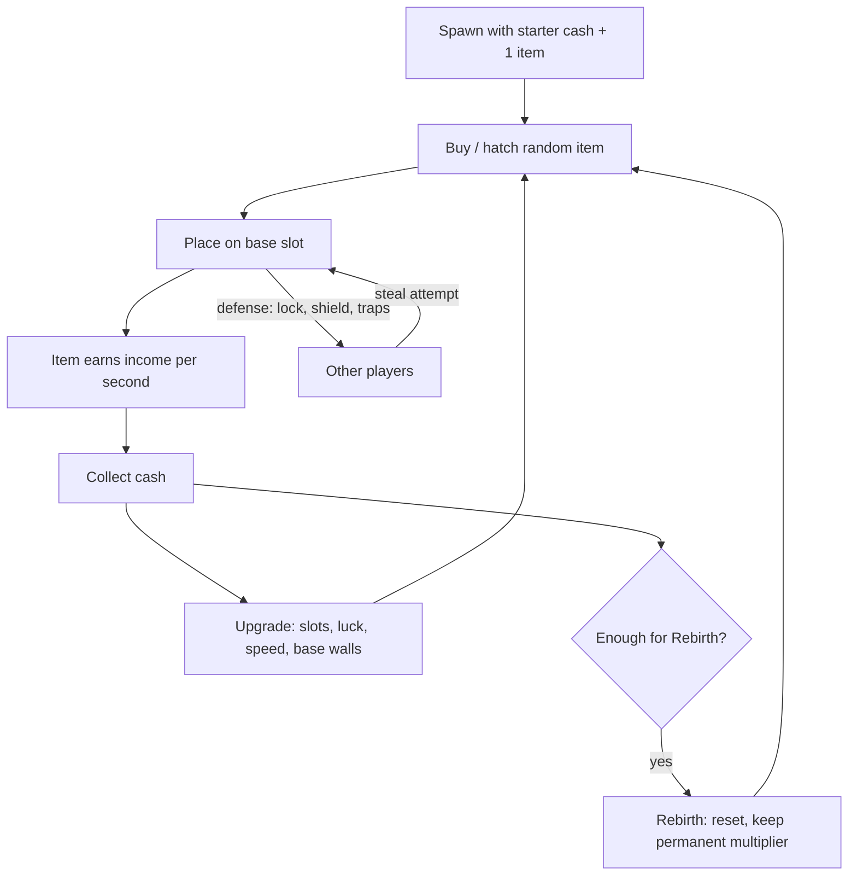

# Steal and Collect Tycoon Formula

The dominant new-launch genre of 2025–26 is the **steal-and-collect tycoon**: buy or hatch random collectibles, place them on a personal base where they earn passive income, upgrade the base, defend it from other players who can steal your best items, then rebirth for a permanent multiplier. On the chart it covers [[Steal An Egg]], [[Break and Steal an Egg]], [[Throw Food For Animals]], [[Steal a Brainrot]] and the earlier garden-style [[Grow a Garden]]. This note extracts the shared formula so it can be adapted (patterns, not names or assets).

## Why this genre won

- **Instant comprehension:** one clip shows buy -> earn -> steal. See [[What Makes a Roblox Game Go Viral]].
- **Passive income** lets players log off and return to a number that grew: built-in return reason ([[Retention and Progression Systems]]).
- **Stealing** creates drama, revenge and content.
- **Rarity tables** give a lottery-like emotional peak with a clear collection goal.
- **Rebirth** converts a plateau into a restart with a faster loop.
- **Cheap to build, cheap to reskin:** a trend meme or theme can be swapped quickly (meme pipeline, see [RoWatcher](https://rowatcher.com/news/from-brainrot-to-skibidi-how-roblox-became-tiktok-s-gaming-mirror), opinion).
- Roblox's chart shows the pattern working repeatedly: Steal a Brainrot (May 2025) reached 25.4M CCU; Steal An Egg (July 2026) followed with 6B visits in its first quarter ([Wikipedia](https://en.wikipedia.org/wiki/Steal_a_Brainrot), [Otakukart](https://otakukart.com/robloxs-steal-an-egg-reaches-6-billion-visits-and-14-2-million-peak-concurrent-players/)).

## The loop

Steal a Brainrot specifics: a conveyor belt in the middle of the map sells characters; items earn over time; players can steal from each other's bases; a temporary shield button, traps and items defend; rebirth resets progress for better stats ([Wikipedia](https://en.wikipedia.org/wiki/Steal_a_Brainrot)). Steal An Egg specifics: collect eggs, hatch pets, upgrade bases and treadmills, train speed, steal eggs from others; eggs/pets vary by rarity, size and mutation ([Otakukart](https://otakukart.com/robloxs-steal-an-egg-reaches-6-billion-visits-and-14-2-million-peak-concurrent-players/)).

## Components checklist

### 1. Personal base
- One plot per player, instanced in the server (8–16 plots is common; exact numbers vary — unverified).
- Slots for placed items; floors can unlock; visible income-per-second sign above each item.
- A **lock/shield timer** after purchase so thieves do not instantly strip a new player.

### 2. Acquisition (the gacha)
- Conveyor, shop restock, or egg hatching. Each roll is a variable-ratio reward.
- **Rarity table** (typical shape; tune to your economy):

| Tier | Example drop rate | Income multiple vs Common | Emotional role |
|---|---|---|---|
| Common | 55–70% | 1x | Filler, teaches loop |
| Uncommon | 20–25% | 3–5x | Early upgrade |
| Rare | 8–12% | 10–20x | First "nice!" |
| Epic | 2–4% | 50–100x | Clip-worthy |
| Legendary | 0.5–1% | 300–1000x | Server announcement |
| Mythic/Secret | <0.1% | 5,000x+ | Streamer moment, tradable status |

(These are *design starting points*, not measured values from any game.) Add **mutations/sizes** as secondary multipliers so even common drops can surprise (Steal An Egg has rarities, sizes and mutations).

- If players can pay Robux for luck or random items, disclose exact percentages and handle regional restrictions; see [[Monetization Patterns]] and [Paid random items](https://create.roblox.com/docs/production/monetization/paid-random-items).

### 3. Income and offline earnings
- Income per second = sum of item rates x multipliers (rebirth, luck, event).
- **Offline/AFK income** is the strongest return hook: cap it (e.g., 2–8 hours) and offer extension via pass or subscription. Passive income is a defining trait of these games ([Wikipedia](https://en.wikipedia.org/wiki/Steal_a_Brainrot)).
- Show a "welcome back, you earned X" popup with a double-it Robux/ad option (rewarded video is recommended by Roblox staff as optional monetization, see [DevForum](https://devforum.roblox.com/t/boost-your-discovery-by-building-games-people-want-to-play/4779042)).

### 4. Stealing and base defense
- Steal action: grab -> carry to own base -> succeed or get caught/knocked. Capture-the-flag-style, with many targets ([Aftermath](https://aftermath.site/brainrot-roblox-court/)).
- Defense layers: physical walls/doors, **temporary shield button** (cooldown), traps, guard pets, and a **post-purchase protection window**.
- Balance: thieves must feel they might win; owners must feel they can respond. Add notification + teleport-to-base so stolen goods can be chased.
- Anti-grief: cap steals per time, protect new players for the first X minutes, never let stealing destroy the *last* item.

### 5. Rebirth / prestige
- Reset cash/items, keep permanent multiplier and some unlocks; require a large milestone (see [[Retention and Progression Systems]]).
- Display rebirth count on the overhead tag for status.

### 6. Social proof
- Server-wide notification when anyone rolls Legendary+.
- Overhead tags (income, rebirths), leaderboards, Rare-item showcase on base.
- Friend/Server hop to join friends (see [[Social Features and Multiplayer Hooks]]).

### 7. Monetization hooks
- Luck potions/passes, auto-collect, x2 cash, extra slots, instant hatch, VIP, limited pets, premium conveyor speed, safe-base protection.
- Price anchors and tiered pass prices in [[Monetization Patterns]]. Do not make paying the *only* way to defend; pay-to-win perception hurts retention (a roughly 30% drop-off figure appears in a third-party analysis, unverified) ([RoWatcher](https://rowatcher.com/news/roblox-monetization-strategies-that-actually-work-in-2026)).

### 8. Live ops
- Weekly new items; admin abuse events; crossovers; limited seasonal drops ([[Live Ops and Update Cadence]]).
- Steal a Brainrot's peaks came from events: an Aug 23, 2025 mock admin war with Grow a Garden, a Sept 13, 2025 Extinct Event, and a January 2026 concert ([Wikipedia](https://en.wikipedia.org/wiki/Steal_a_Brainrot)).

## Why it spreads (virality map)

| Spread vector | Mechanism |
|---|---|
| Short video | Rare reveal + theft reactions ([Aftermath](https://aftermath.site/brainrot-roblox-court/)) |
| Meme IP | Italian brainrot characters had existing audience ([Wikipedia: Italian brainrot](https://en.wikipedia.org/wiki/Italian_brainrot)) |
| Friends | Stealing from friends and visiting bases |
| Creators | Streamers show loot and base defense |
| Roblox algorithm | High play days and session time when passive income brings return visits ([Discovery](https://create.roblox.com/docs/discovery)) |
| Copycats | The genre template is cloned quickly; many "Steal a ..." and "Break and Steal" variants exist, with some IP disputes ([MobileGamer.biz](https://mobilegamer.biz/everything-you-always-wanted-to-know-about-roblox-brainrot-but-were-afraid-to-ask/)) |

## Risks and lifecycle

- **Decay after peaks:** brainrot titles show steep falls after event peaks and then a floor (Steal a Brainrot ~25.8M -> ~215K per one tracker; Escape Tsunami for Brainrots ~5M -> ~164K) ([RoWatcher](https://rowatcher.com/news/is-the-brainrot-trend-dying-what-ccu-data-from-three-top-games-reveals)).
- **Cheating/automation:** auto-farm scripts were widely reported in Steal a Brainrot ([Wikipedia](https://en.wikipedia.org/wiki/Steal_a_Brainrot)); build server-authoritative logic (see 08 Coding notes: [[Steal and Base Systems]], [[Pet Egg and Gacha Systems]]).
- **Platform risk:** one third-party blog reports Steal An Egg was briefly pulled over a feature later restricted (single-source, unverified) ([StudioKrew](https://studiokrew.com/blog/top-roblox-games-september-2026/)). Check mechanics against Roblox policies, including paid random items and trading.
- **Similarity penalty:** Roblox deprioritizes experiences whose metadata and place files closely resemble existing ones ([Discovery](https://create.roblox.com/docs/discovery)); Standout Games calls reskins "a hard sell" ([Standout Games](https://create.roblox.com/docs/creator-programs/standout-games)). Differentiate with a new twist (theme, mechanic, art).
- **Pay-to-win perception** and child-spending concerns; see ethics in [[Monetization Patterns]].

## Differentiation ideas (patterns, not copies)

- Change the *verb of stealing* (race, puzzle, minigame) rather than just the skin.
- Add co-op bases or guild bases.
- Add a visible **economy loop** that is not RNG (crafting, breeding).
- Add a **seasonal world** that changes the item pool every week.
- Add a skill-based defense minigame so defenders are not only paying for shields.

## Build order (a studio blog estimates 10–14 weeks and $25K–75K for a mid-size game with a live content pipeline; unverified)

1. Base + one item type + passive income + cash UI.
2. Buy/hatch + rarity roll + reveal animation.
3. Steal mechanic + shield + protection window.
4. Upgrades + rebirth.
5. Leaderboards + server announcements.
6. Passes/dev products + odds UI.
7. Event system + weekly drop pipeline.

## References

- [Steal a Brainrot (Wikipedia)](https://en.wikipedia.org/wiki/Steal_a_Brainrot) — encyclopedia · loop, defense, rebirth, events, records
- [Steal an Egg 6B visits (Otakukart)](https://otakukart.com/robloxs-steal-an-egg-reaches-6-billion-visits-and-14-2-million-peak-concurrent-players/) — press · egg/steal mechanics
- [Aftermath: brainrot court](https://aftermath.site/brainrot-roblox-court/) — press · capture-the-flag framing, base as jail
- [MobileGamer.biz: Roblox brainrot](https://mobilegamer.biz/everything-you-always-wanted-to-know-about-roblox-brainrot-but-were-afraid-to-ask/) — trade press · lawsuit, copies
- [RoWatcher: brainrot trend](https://rowatcher.com/news/is-the-brainrot-trend-dying-what-ccu-data-from-three-top-games-reveals) — blog · decay data
- [RoWatcher: Skibidi to brainrot pipeline](https://rowatcher.com/news/from-brainrot-to-skibidi-how-roblox-became-tiktok-s-gaming-mirror) — blog · reskin and monetization tactics (opinion)
- [RoWatcher: monetization 2026](https://rowatcher.com/news/roblox-monetization-strategies-that-actually-work-in-2026) — blog · pass pricing, P2W drop-off
- [Italian brainrot (Wikipedia)](https://en.wikipedia.org/wiki/Italian_brainrot) — encyclopedia · meme origin
- [Top Roblox games Sept 2026 (StudioKrew)](https://studiokrew.com/blog/top-roblox-games-september-2026/) — blog · speed progression, cost estimate (unverified)
- [Discovery (Creator Docs)](https://create.roblox.com/docs/discovery) — official docs · non-unique games rank lower
- [Standout Games (Creator Docs)](https://create.roblox.com/docs/creator-programs/standout-games) — official docs · novelty criteria
- [Paid random items (Creator Docs)](https://create.roblox.com/docs/production/monetization/paid-random-items) — official policy · odds disclosure
- [Boost your discovery (DevForum)](https://devforum.roblox.com/t/boost-your-discovery-by-building-games-people-want-to-play/4779042) — Roblox staff post · optional rewarded monetization
- [Grow a Garden (Fortune)](https://fortune.com/2025/07/30/roblox-video-game-grow-a-garden-viral-summer-hit/) — press · garden-style loop and shared restock

Links: [[Game Design MOC]] · [[00 Home]]
