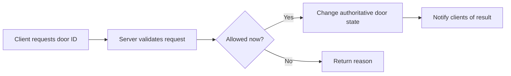

# Networking and Remotes

Design each remote as a small, documented request across a trust boundary. The transport choice does not establish permission to change game state. Reviewed against official documentation on 2026-11-02; no implementation was run in Studio.

## Choose the transport

| Need | Starting choice | Design consequence |
|---|---|---|
| Request an interaction or publish a result | RemoteEvent | One-way; add an application response when the UI needs acknowledgement |
| Get a result before continuing | RemoteFunction | Caller yields; avoid making essential server work depend on a client reply |
| Frequently changing, disposable visual data | UnreliableRemoteEvent | May arrive late, out of order, or never; not suitable for currency or inventory |

Roblox documents these transport distinctions and warns that `InvokeClient()` may error or wait indefinitely. Reliable delivery is scoped to a connected recipient, not durable storage. A yielding handler can overlap later work. [Remote events and callbacks](https://create.roblox.com/docs/scripting/events/remote).

## Original contract example: request to open a door

This is a proposed design exercise, not a reconstruction of [[Doors]] or [[Pressure]].

Define the following in [[Feature Build Contract]] before writing handlers:

- **Request:** door identifier and an optional correlation identifier. Do not accept a client-selected reward, price or permission.
- **Authority:** the server owns door state, access rules and any inventory changes. The client owns button feedback and presentation.
- **Responses:** success, already open, out of range, unavailable, or invalid request. Decide which messages the player sees.
- **Repeat behavior:** two players opening one door should produce one state transition. Specify whether repeated requests return the existing result.
- **Lifecycle:** define what happens when the requester disconnects, the room unloads, or the UI times out. A timeout alone does not prove the action failed.

Use [[Security and Anti-Exploit]] for validation and [[Data Saving and Player Profiles]] when an action changes persistent progress.

## Checks to run in the actual project

| Scenario | Proposed acceptance evidence |
|---|---|
| Invalid ID, wrong payload type, excessive length | Rejected without unrelated state changes |
| Two simultaneous requests | One authoritative transition |
| Artificial delay and repeat click | UI resolves to the final server state |
| Client leaves during request | No server thread or operation waits forever on that client |
| Missing cosmetic messages | Authoritative state and rewards still correct |

Record results in [[Playtest Record]]. Buffers, serialization libraries and compression choices need separate research and profiling; no universal packet budget is claimed here.

## Mentioned in

- [[Audio Implementation in Luau]]
- [[Combat and Impact Sounds]]
- [[Cutscenes and Camera Work]]
- [[Fisch]]
- [[The Strongest Battlegrounds]]
- [[VFX Implementation in Luau]]
- [[What Every Roblox Game Needs]]

## References

- [Remote events and callbacks](https://create.roblox.com/docs/scripting/events/remote) — official guide · transport and callback behavior.
- [[Feature Triage and Build Contract]] — original planning workflow · request ownership and acceptance.

Links: [[Coding MOC]] · [[00 Home]]
